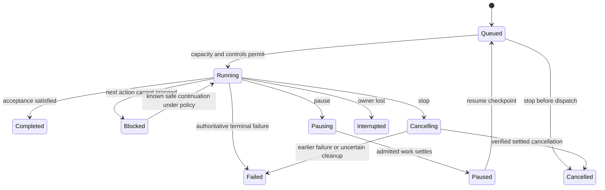

# Council functional specification

Status: product baseline for review. Date: 5 November 2026.

This document defines the first release's behavior. The [requirements](functional-requirements.md)
provide stable FR identifiers; the [vision](vision.md) explains the product. Technology, storage
schemas and wire formats are selected in feature plans. Proposed behavior here is not a claim that
the replacement is implemented or that live provider accounts have been qualified.

## 1. Operating model and defaults

Council owns an admitted local workflow. Closing an observing browser or disconnecting a host does
not require another model to keep polling or silently cancel that workflow. Stopping the owning
service requests orderly shutdown; an unexpected owner exit requires reconciliation on restart.
The same task and execution identities are used by the UI, CLI and host interface.

| Decision | Default behavior |
| --- | --- |
| Primary user | One programmer on a local machine, with multiple projects and existing agent connections. |
| Start a task | Choose a project and describe an outcome. `Auto` selects appropriate execution details. |
| Autonomy | Select the autonomous full-access preference once during setup; persist and show it. Narrower task overrides remain available. No repeated tool-approval questionnaire is part of the normal journey. |
| Available agents | Reuse installed harnesses and their own authentication. Installation, authentication, capabilities, local occupancy and allowance are separate observations. |
| Model use | Prefer a suitable smaller/economical target, account for total work and use permitted included capacity. Do not spend a model call on ordinary routing or waiting. |
| Unknown information | Keep unknown model identity, allowance, price, external activity and unreported tokens visible. Unknown does not mean exhausted, free, idle or zero usage. |
| Context | Provide the current brief, every applicable original constraint and relevant evidence. Retrieve further source as needed; preserve full originals outside the prompt. |
| Local destination | The selected project's current working destination, captured at start. Autonomous policy can authorize applying the verified task delta there. Preview/review-only output is also supported. |
| Commit and publish | Do not commit unrelated user edits. Commits, remote pushes, releases and deployments occur only when the task's explicit scope includes the corresponding action and destination. |
| Payment | No silent Council-managed switch from subscription/local execution to paid API usage. Externally configured native-harness billing remains outside Council's enforceable guarantees. |
| Simulation | An explicitly labelled local fake mode for demonstrations and acceptance, never presented as live agent work. |

An inherited publication policy counts as authorization only if it explicitly names the action and
destination and is captured in this task's scope. Full tool access alone is not that authorization.
Requested and effective permissions are retained separately; a provider restriction is reported
without pretending that Council overrode it.

## 2. Main user surfaces

| Surface | What the programmer can do | Information kept out of the primary path |
| --- | --- | --- |
| Tasks | Open a project, describe work, start with Auto, continue recent work and see the next required action. | Voting weights, transport JSON, arbitrary role panels and multiple competing inboxes. |
| Task detail | Follow stages; inspect the result, changes, checks, findings, observed usage and full activity; stop, pause or recover as supported. | Internal slot identifiers, database schema generations and raw protocol frames unless diagnostics are opened. |
| Connections | Discover or select installed harnesses, see capabilities and connection limits, link an account explicitly, supply an optional fresh busy/available observation. | Mandatory price tables, model benchmarks or manually maintained provider taxonomies before the first task. |
| Preferences | Change the saved autonomy/usage policy and infrequent project or connection details. | Requiring the same choices at each start. |
| CLI and host | Start, wait, inspect and control the same work; obtain supported host connection instructions or perform an explicitly requested registration. | A separate lifecycle or a second phase plan the user must maintain. |

Use the verified [Ejupi Labs identity](design-identity.md), with approved SVG geometry, its icon
family, system reading typography and documented palette. Render meaningful empty, loading,
blocked, failed and recovery states. Status must have a text label as well as colour. A detail
refresh must not erase a draft, change the selected task or let an obsolete response repaint it.

## 3. Open a project and connect harnesses

1. Select or open an existing project. Resolve its actual identity and current working destination;
   paths with spaces, Unicode and ordinary aliases are supported.
2. Show available installed harnesses. Metadata discovery does not make a model call, start login,
   copy vendor state or install a missing agent. A timeout or missing executable affects that
   connection rather than blocking every other connection.
3. Separate installation, supported adapter version, authentication evidence, model options,
   permission capabilities and capacity. Use a provider-owned supported interface for additional
   discovery when available; otherwise retain `Unknown` or `Not verified`.
4. Reuse an existing signed-in harness. If login is required, offer the vendor's supported next
   action. Council does not import credentials or infer an account identity from a harness name.
5. Save the user's autonomy preference. Show the effective capability of each connection; reject
   a stage that requires an unsupported capability before dispatching that stage.

The five target harnesses are Codex, Claude Code, DeepSeek Harness, Junie and Antigravity. They do
not have to implement identical optional capabilities. Adapter maturity, tested versions and
qualification evidence are visible. A direct model API is a distinct execution path, not a way to
claim reuse of a coding-harness subscription.

## 4. Admit a task

The required input is a project and an original task description. Additional acceptance checks,
attachments, exact target/model pins, destination and policy overrides are optional. Council
preserves the original input unchanged and records any generated interpretation separately.

Before an attempt starts, validate input, project/destination, required capabilities, current
guidance, ownership, cancellation and applicable capacity/budget. Record a durable identity before
launch. A repeated start with the same operation identity returns that admitted operation or an
explicit conflict; loss of an acknowledgement does not authorize a duplicate launch.

The normal start does not require a separate plan-confirmation click. Show the resolved plan and
choice reasons as the work progresses. Ask for input only when a material blocker lacks an
authorized default, such as an ambiguous external destination or conflicting task constraints.

Auto policy is bounded. It accounts for implementation, planning when needed, reviews, corrections,
consultations and escalation in one task budget. The selected allowance and remaining bounded
work are inspectable. A recursive team, extra reviewer or repeated failed attempt cannot create
its own unrecorded budget.

## 5. Route proportionately

The routing decision first respects explicit pins, necessary capabilities, effective permissions,
task constraints and payment eligibility. It then applies the published suitability/economy policy
and account capacity preferences. A shorter task description is not evidence that a task is safe
or easy; a marketing model name is not a measured quality score.

| Situation | Required behavior |
| --- | --- |
| A suitable small target and larger target are available for a bounded routine change | Prefer the configured suitable economical target; record the reason without an extra classifier call. |
| Personal Codex is reported busy and suitable Claude capacity is reported available | Assign background work to the eligible Claude account under the policy, without modifying the existing Codex conversation. |
| Several targets share an explicitly linked subscription | Use one account occupancy/allowance pool. Do not multiply capacity by the number of aliases. |
| External occupancy or remaining allowance is not observable | Show unknown. Account eligibility follows the saved policy; do not force invented quota maintenance or label the account idle. |
| A fresh exhaustion/denial/cooldown report exists | Honor that evidence at new admission. An old positive report cannot erase the newer failure; passing a reset time alone does not refill the account. |
| An exact pinned target is unavailable | Wait under the task's policy or report the blocker. Do not silently substitute a different account, model, provider or payment path. |
| A necessary check fails or required context cannot be handled by the selected target | Correct, retrieve/narrow context or escalate only as the policy allows, with a concrete reason and remaining budget. |
| The provider's model choice is a selector/alias or native default | Record the requested selector and any reported effective identity separately. An unreported identity remains unresolved. |

Selection considers total expected work. A small first attempt that requires repeated expensive
repairs is not automatically economical. Observed task outcomes may inform future eligibility,
with their provenance; they do not create a universal intelligence leaderboard.

## 6. Execute an appropriate workflow

### A bounded direct task

Prepare relevant context, run one suitable worker, perform the necessary deterministic checks and
deliver or integrate the result under the task policy. A sufficiently verified routine edit does
not require a committee, debate, planning model or independent reviewer solely to satisfy a mode.
An investigation can complete with a supported evidence-based answer without producing a patch.

### A change that requires independent review

Run an implementer, give a compatible reviewer the actual candidate and required source/evidence,
record findings and unperformed checks, correct blocking findings, rerun affected verification,
then integrate or deliver the accepted candidate. The reviewer must have the evidence/access
needed for its role. A response saying that source was inaccessible is not an approval of that
source. An author's statement that tests ran is not a Council-observed verifier receipt.

Blocking findings have stable identities and link to the corrected candidate and new checks.
Original failed attempts remain failed; a later verified correction can still complete the task.
Do not rerun unrelated successful work merely because a different stage needs correction.

### A feature with independent and dependent work

Represent tasks and prerequisites explicitly. Admit independent work within capacity. A dependent
worker receives the accepted predecessor change/base in its actual working context, or a specific
blocker. A separate patch path is not proof that those files exist in that workspace. Failure of a
prerequisite blocks its dependents while already admitted siblings settle and keep their results.

### Context and communication

Each stage receives its task/guidance version, applicable original constraints, relevant artifact
and source identities, required checks, prior findings and unresolved questions. Focus context on
that stage. Preserve full results and originals for explicit retrieval. Derived summaries identify
their source and do not change authority or silently omit acceptance-critical material.

Supported harness/tool calls or validated task-scoped result artifacts may carry structured
orchestration data. Arbitrary assistant prose cannot authorize a new task, payment path or
publication. Do not recover a plausible JSON substring from an opaque answer and pretend that it
was an authoritative whole response. Incompatible structured-control capabilities lead to a
supported alternative stage or a clear limitation, not a hidden format repair.

## 7. Verify and integrate

Verification receipts identify the candidate/source state, exact check and working context,
terminal outcome and supporting output. Required checks distinguish passed, failed, not run and
unavailable. A source edit invalidates affected earlier checks for acceptance while retaining
their historical receipts. A check that never ran cannot become passed through a summary.

Record the starting project state and preserve pre-existing edits. A managed working candidate
must include the relevant current source state; starting from an old clean commit must not silently
discard uncommitted source that the task depends on. Do not automatically copy vendor credentials,
ignored authentication state or Council state into a work area.

For autonomous local integration, apply only the verified task delta to the captured destination,
preserving unrelated edits and staging state. Check that the relevant destination has not changed
incompatibly. If a new user edit, branch change or conflict prevents safe application, retain the
candidate and explain the conflict. Do not hard-reset, silently stash or overwrite user work.
Review-only policy retains an inspectable candidate and names the remaining apply action.

Results separately state what was authored, reviewed, verified, integrated and published, according
to the requested deliverable. A task can complete as a requested review or patch delivery without
claiming that those changes were applied. External effects use the explicit task scope and retain
their own result evidence.

## 8. Lifecycle and controls

The current execution has a state; its individual stage attempts and acceptance evidence retain
their own outcomes. A terminal execution record is not rewritten by a later retry. A task may
start a new linked execution using retained context after explicit retry/recovery authorization.

| State | User-visible meaning |
| --- | --- |
| Queued | Admitted and waiting for eligible capacity; no implication that a model call has started. |
| Running | The workflow is preparing, implementing, reviewing, verifying or integrating. Show its actual stage and owner. |
| Pausing / Paused | New admission is stopped. Pausing still has admitted work settling; Paused has a resumable checkpoint. This is not process suspension. |
| Blocked | A named dependency, capability, budget, account, context or integration issue prevents the next action. Active sibling drainage is shown separately. |
| Cancelling / Cancelled | Stop was accepted and owned work is settling / cancellation has reached its recorded terminal outcome. Request acknowledgement alone is not proof of quiescence. |
| Completed | The requested deliverable and every required acceptance condition are satisfied for the recorded candidate. |
| Failed | Required work failed after the allowed recovery/correction path, or an authoritative fault prevents a valid conclusion. Retain partial useful work. |
| Interrupted | Ownership or terminal evidence was lost. Reconcile before starting replacement work; do not infer that writes never occurred. |

Pause/resume retains completed identities; it does not replay writes. New guidance is versioned.
Already dispatched work retains its original instruction snapshot, while future admission checks
the current version. Stop is available when already dispatched work should not continue.

## 9. Failure, recovery and observation

| Event | Required handling |
| --- | --- |
| Invalid input or unsupported setting | Reject before the affected launch, with the invalid choice and supported next action. |
| Provider/authentication/tool denial | Retain the actual outcome and evidence; use only the task's permitted fallback. Do not silently broaden permissions or change a pin. |
| Wait timeout or disconnected observer | Keep the execution identity and actual state. Stopping a wait does not stop the task. |
| Lost terminal acknowledgement or owner crash | Inspect ownership, retained artifacts and known completed identities before recovery. Unknown completion is not a replay permission. |
| Storage failure after work started | Retain the failure, stop conflicting admission and settle owned work. Do not repeat a model call to reconstruct lost evidence. |
| Unverified process-tree cleanup | Keep the attempt failed/uncertain, retain its earlier diagnostic and prevent dispatch that may overlap that owned work until reconciliation. |
| Destination conflict | Keep both the candidate and user state; show the exact remaining integration action. |
| Stale client read or repeated request | Preserve newer selections/drafts and use operation identities/revisions to avoid duplicate work or silent overwrites. |

Status observation, waits, history and evidence inspection make no model calls. Routine updates
carry compact metadata; full bodies are read explicitly in stable bounded sections/pages. The
retained original is complete even when the visible card is a preview. Private/task-scoped
content is not broadcast simply because it is useful to a different participant.

Backup/export identifies its scope, source identities and compatibility. Restore verifies the
backup before use and does not resume old writers automatically. Cleanup operates on reviewed
owned artifacts, preserving later edits, unrelated paths and unaccepted work unless disposal is
explicitly authorized. The legacy 1.3 data remains separate; no silent migration is in scope.

## 10. Acceptance and release targets

The following are release qualification targets, not claims of measurements already achieved:

- With prerequisites already installed/signed in, the ordinary setup reaches a task composer
  without transport JSON or mandatory model/account tuning forms.
- A start or control action immediately shows pending feedback; local state acknowledgement is
  measured separately from model/provider latency. Detailed feature plans set reproducible bounds.
- An idle board, a pending wait and evidence reads add exactly zero model calls in controlled tests.
- A project with 10,000 retained task records still uses compact initial views and bounded reads;
  complete history is available without skipped entries or a whole-history prompt.
- The fresh-install package needs no compiler or development dependency installation for ordinary
  use. Supported OS/architecture prerequisites and actual CI coverage are documented.
- The primary task path is keyboard-operable, has visible focus and named controls, readable
  contrast and non-colour state cues. Responsive and reduced-motion behavior are checked in a
  real rendered UI against the approved brand references.

| Qualification journey | Required evidence | Main requirements |
| --- | --- | --- |
| Q01 Open and connect | Fresh installation, Unicode project path, truthful discovery, saved autonomy and no credential changes. | FR-001–FR-010 |
| Q02 Proportionate work | Suitable small target, recorded choice, correct bounded workflow and no classifier/polling waste. | FR-011–FR-013, FR-017–FR-020, FR-031 |
| Q03 Use another account | Busy personal account, suitable available second account, shared capacity and unknown-data counterexamples. | FR-004, FR-014–FR-020 |
| Q04 Correct a reviewed change | Actual candidate review, blocking finding, correction, affected verifier receipts and accepted result. | FR-021–FR-024 |
| Q05 Dependent feature work | Independent overlap, prerequisite failure, actual predecessor materialization and scoped evidence. | FR-025–FR-030 |
| Q06 Control and recover | Pause/resume, late cancellation, primary failure, owner crash, uncertain cleanup and no replay. | FR-032–FR-037 |
| Q07 Deliver without losing edits | Dirty project, authorized automatic integration, destination conflict and explicit publication scope. | FR-038–FR-041 |
| Q08 Preserve and inspect | Complete evidence, stable reads, backup/restore, reviewed cleanup and stale-client controls. | FR-029–FR-031, FR-042, FR-046 |
| Q09 One branded product | UI/CLI/MCP parity, actual Ejupi Labs assets, keyboard flows and clear English state guidance. | FR-043–FR-046 |
| Q10 Qualify the release | Every planned adapter, complete offline journey, separate live qualification and reviewed feature records. | FR-005, FR-047–FR-048 |

Every numbered feature has its own Specify specification, design, tasks, independent review and
acceptance record. The [delivery plan](delivery-plan.md) orders those features and
[traceability](traceability.md) maps the requirements to their evidence. Passing fake protocols
does not establish live provider availability, account entitlement or measured subscription savings.
